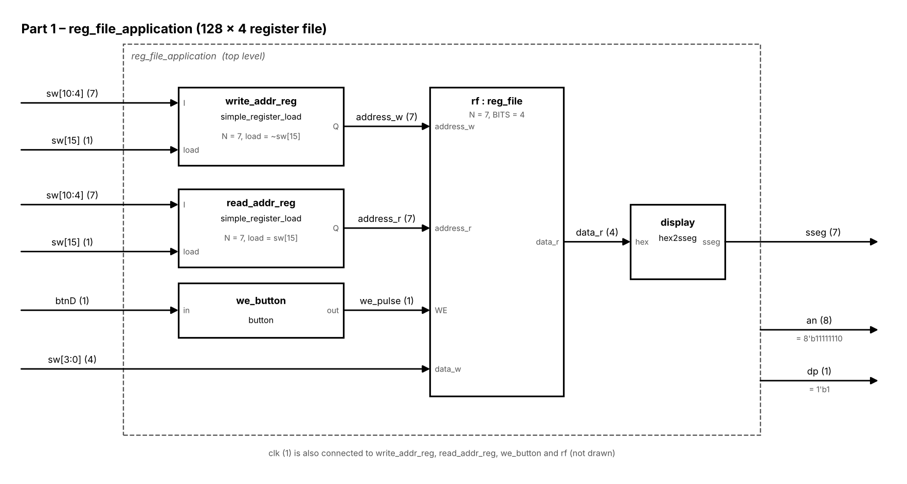
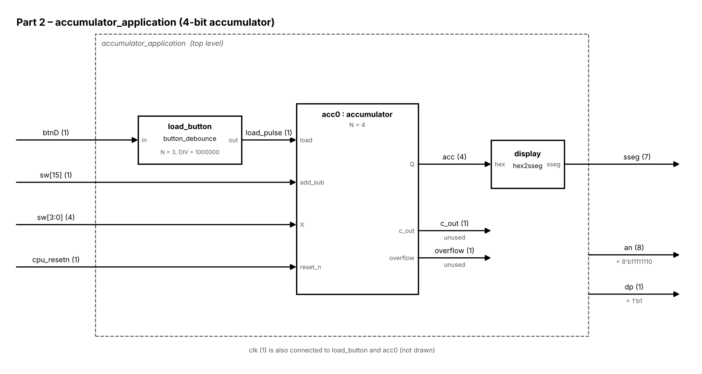

# Lab 4 – Registers
**Course:** ECE 2300L – Digital Logic Design Laboratory
**Board:** Nexys A7-100T
**Tools:** Verilog, Xilinx Vivado

## Files
| File | Description |
|---|---|
| [`simple_register_load.v`](verilog/design/simple_register_load.v) | Starter: N-bit register with load enable |
| [`decoder_generic.v`](verilog/design/decoder_generic.v) | Starter: parameterized N-to-2^N decoder with enable |
| [`hex2sseg.v`](verilog/design/hex2sseg.v) | Starter: hex digit to seven-segment converter |
| [`button.v`](verilog/design/button.v) | Starter: pushbutton to single-cycle pulse |
| [`adder_subtractor.v`](verilog/design/adder_subtractor.v) | Starter: n-bit adder/subtractor with overflow flag |
| [`rca_nbit.v`](verilog/design/rca_nbit.v) | Starter: n-bit ripple-carry adder |
| [`full_adder.v`](verilog/design/full_adder.v) | Starter: 1-bit full adder |
| [`half_adder.v`](verilog/design/half_adder.v) | Starter: 1-bit half adder |
| [`reg_file.v`](verilog/design/reg_file.v) | Part 1: generic register file (N, BITS) with tri-state read port |
| [`reg_file_application.v`](verilog/design/reg_file_application.v) | Part 1: top module, 128 x 4 register file on the board |
| [`register_load_reset.v`](verilog/design/register_load_reset.v) | Part 2: register with load enable and active-low reset |
| [`accumulator.v`](verilog/design/accumulator.v) | Part 2: 4-bit accumulator built from adder/subtractor and register |
| [`button_debounce.v`](verilog/design/button_debounce.v) | Part 2: debounced pushbutton to single-cycle pulse |
| [`accumulator_application.v`](verilog/design/accumulator_application.v) | Part 2: top module, accumulator on the board |
| [`button_tb.v`](verilog/sim/button_tb.v) | Starter: testbench for button |
| [`reg_file_tb.v`](verilog/sim/reg_file_tb.v) | Part 1: self-checking testbench for reg_file |
| [`accumulator_tb.v`](verilog/sim/accumulator_tb.v) | Part 2: self-checking testbench for accumulator |
| [`reg_file_application.xdc`](verilog/constraints/reg_file_application.xdc) | Part 1: board constraints, Nexys A7-100T |
| [`accumulator_application.xdc`](verilog/constraints/accumulator_application.xdc) | Part 2: board constraints, Nexys A7-100T |

## Part 1 – Register File
A generic register file (`reg_file`) was built from `simple_register_load` registers, a write decoder, and a read decoder driving tri-state buffers. It was verified with a self-checking testbench and implemented on the FPGA as a 128 x 4 register file (`reg_file_application`).

**Simulation screenshot:**

**Block diagram:**

**Demo video:**

## Part 2 – Accumulator
A 4-bit accumulator was built from the provided `adder_subtractor` and a register with load and reset. It was verified with a self-checking testbench and implemented on the FPGA (`accumulator_application`).

**Simulation screenshot:**

**Block diagram:**

**Demo video:**

